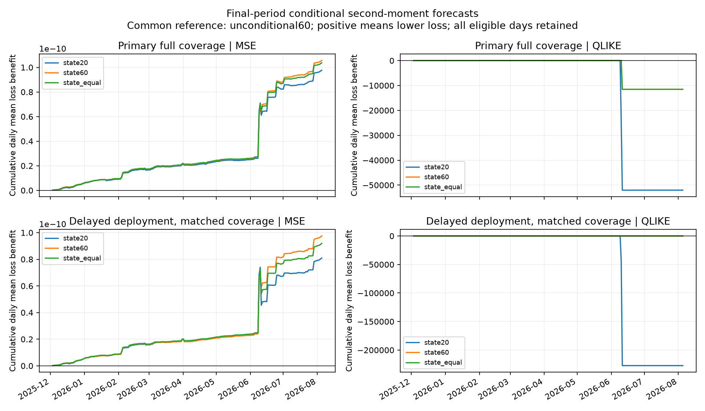

# Increment 3: final-period results and failure audit

The frozen final segment is now **consumed**. The state models retain a modest MSE benefit, but negative forecasts break primary-scenario QLIKE. Neither a universal memory winner nor a tradable edge is established. No model, feature, penalty, floor or mixture weight was tuned after opening final outcomes. The seasonal and positive-link families and failed NVDA specification were not reopened.

## Provenance, scope and timing

Run registered **2026-10-24T20:03:58.384665Z**, before final scoring; processing began **20:04:08.539610Z** and completed **20:16:45.769152Z**. Exact local frozen plan SHA256 is `71521eb2d22dfa12f2109505d63199dac74b649e01413cc2bbbcc6310e146a8b`; the LF-normalized published plan hash is `f457d86511fddc6f975f7de35bcbfb700ac87b49f56c4f0bce81cb680c605e40`. Both conventions are recorded, not confused. All four QQQ source-object hashes matched increment 1 before scoring. See preflight.json and consumption.json; their exact byte/hash chain is preserved in publication.

Final dates are December 3, 2025–August 5, 2026: 168 sessions, 10,717 primary observations and 10,549 delayed observations. Primary matched results use precisely those same 10,549 origin timestamps. State bank remains r1², rv6 and rv12 (5/30/60-minute feature histories), four coefficients including intercept. Coefficient windows are 20 or 60 preceding completed sessions; refit once daily with past-only scaling and ridge penalty1. Unconditional controls have one intercept at the same histories. Equal mixtures have fixed 50/50 weights, no fitted aggregation history, and average the floored component forecasts. Earlier final-session labels enter later fits only after maturity, exactly as frozen.

The primary target is a squared five-minute log return, a noisy conditional second-moment proxy, not observed latent variance. The delayed scenario keeps the same feature cutoff, assumes deployment five minutes later, shifts the target five minutes and refits to that shifted target. It is a **delayed-availability/deployment scenario, not pure same-target information-staleness isolation**.

Concrete first-day example, December 3 in America/New_York (EST; UTC is five hours later):

| Clock item | Primary | Delayed deployment |
|---|---|---|
| Last feature bar's timestamp | 10:30 | 10:30 |
| Feature information cutoff, assuming start-labeled bars | 10:35 | 10:35 |
| Assumed usable/deployment time | 10:36 | 10:41 |
| Return target start/end | 10:40–10:45 | 10:45–10:50 |
| Label maturity, including60sec allowance | 10:46 | 10:51 |

Bar-start labels and historical60sec release remain unverified assumptions. Targets use exact contiguous300sec observations and never cross sessions. Short-session13:00 stamps remain a convention question, not proof of actual post-close availability. All eligible sessions stay in main results.

## Absolute losses and common denominators

Primary floor is1e-12. MSE means mean squared error of the squared-return proxy; units are return-to-the-fourth-power. It emphasizes large absolute second-moment errors. QLIKE means quasi-likelihood, here log(f)+y²/f; it is sensitive to relative underprediction and especially forecasts near zero. Negative QLIKE values are normal. These answer different operational error questions; neither was selected after seeing the final period.

**Primary, prediction-weighted** (every eligible origin has equal weight):

| Model | MSE ×1e12 | MSE / common unconditional60 | MSE / own matched control | QLIKE |
|---|---:|---:|---:|---:|
| Unconditional20 | 8.096830 | 1.001759 | 1.000000 | -12.927525 |
| Unconditional60 | 8.082614 | 1.000000 | 1.000000 | -12.914293 |
| Unconditional equal | 8.059049 | 0.997085 | 1.000000 | -12.935770 |
| State20 | 7.501104 | 0.928054 | 0.926425 | 297.792195 |
| State60 | 7.453608 | 0.922178 | 0.922178 | 55.974863 |
| State equal | 7.465006 | 0.923588 | 0.926289 | 55.968018 |

**Primary, equal-day** (each of168 session means has equal weight):

| Model | MSE ×1e12 | QLIKE |
|---|---:|---:|
| Unconditional20 | 8.071414 | -12.93193 |
| Unconditional60 | 8.058270 | -12.91768 |
| Unconditional equal | 8.034222 | -12.93958 |
| State20 | 7.476845 | 296.7740 |
| State60 | 7.429670 | 55.74473 |
| State equal | 7.440940 | 55.73749 |

Changing denominators is not a memory advantage: the common-control table and direct pairs are the relevant cross-memory comparisons. Prediction-weighted state20 minus state60 MSE is +4.749594e-14, five-session block95% interval [-2.583237e-14,1.483201e-13]. The point estimate favors60 locally; the interval does not separate them. Twenty versus sixty sessions says nothing about all longer histories. The earlier seasonal result concerns only one fixed quadratic basis, not a rejection of state conditioning generally.

Against the common unconditional60, paired primary MSE differences for state20/state60/equal are -5.815102e-13/-6.290061e-13/-6.176082e-13. Their block intervals are [-1.116672e-12,-2.345622e-13], [-1.177452e-12,-2.675305e-13], and [-1.168118e-12,-2.602487e-13]. Primary QLIKE differences are instead +310.7065/+68.88916/+68.88231; intervals are very wide and span zero because resampled blocks sometimes omit the few catastrophic days. This is not reassurance about their reliability.

All paired losses, both weighting conventions, own/common controls and floors are in scores.csv and paired-contrasts.csv. Bootstrap uses2,000 circular five-session blocks, seed20261024, with fitted forecasts held fixed. It captures some local dependence but not all60-session parameter-estimation dependence, nonstationarity, model-search uncertainty or source-timing error. Intervals are descriptive, not universal or multiplicity-adjusted guarantees.

## Delayed deployment on matched origins

| Model | Primary matched MSE ×1e12 | Delayed MSE ×1e12 | Primary matched QLIKE | Delayed QLIKE |
|---|---:|---:|---:|---:|
| Unconditional20 | 8.084397 | 8.034439 | -12.93520 | -12.94001 |
| Unconditional60 | 8.064853 | 8.019693 | -12.92345 | -12.92792 |
| Unconditional equal | 8.043952 | 7.997372 | -12.94397 | -12.94920 |
| State20 | 7.486455 | 7.538127 | 302.7327 | 1344.452 |
| State60 | 7.436426 | 7.438833 | 57.06353 | -13.19670 |
| State equal | 7.449013 | 7.472606 | 57.05737 | -13.20539 |

Delayed MSE/common-control ratios are0.939952/0.927571/0.931782 for the state models. Delayed equal-day MSE is7.513388e-12/7.414599e-12/7.448164e-12; QLIKE1339.956/-13.20159/-13.21066. State60 and equal avoid the delayed scenario's floor catastrophe, while state20 does not. Because targets and fits change, these numbers cannot identify a pure causal effect of information staleness or establish60 as generally robust.

## Every floor event and training-range exposure

Every binding event is a negative raw forecast; there are no additional small-positive floor events. Unconditional components never bind. At1e-12, primary state20 has3 events/10,717 and state60 has1; delayed state20 has2/10,549 and state60 has0. The same events bind at every declared floor. Matching coverage does not remove any event.

| Scenario/model | Feature bar stamp, Eastern | Raw forecast | Realized squared return | Outside any training marginal feature range? |
|---|---|---:|---:|---|
| Primary state20 | June10 13:45 | -1.680038e-6 | 1.583212e-6 | No |
| Primary state20 | June11 13:25 | -1.375902e-5 | 7.412853e-7 | Yes |
| Primary state20 | June11 15:30 | -2.032383e-7 | 1.008414e-6 | No |
| Primary state60 | June11 13:25 | -2.615838e-7 | 7.412853e-7 | Yes |
| Delayed state20 | June10 13:45 | -2.042269e-7 | 2.766666e-6 | No |
| Delayed state20 | June11 13:25 | -3.740590e-6 | 1.155531e-5 | Yes |

Both primary components hit the floor together on June11, so equal weighting does not diversify that failure. Primary QLIKE at floors1e-14/1e-12/1e-10 is31086.09/297.792/-10.0895 for state20,6903.715/55.9749/-12.5021 for state60, and6903.709/55.9680/-12.5090 for equal. Even the larger diagnostic floor leaves all primary state models worse than unconditional under QLIKE. The floor is not tuned away.

Primary20/60 windows encounter183/48 origins outside at least one training marginal feature range, with maximum absolute training-standardized states41.85/54.46. Delayed counts181/48 and maxima41.55/54.06. On the shared June11 failure, maxima are39.60/54.46 for primary20/60. The other negative forecasts occur inside individual feature ranges: marginal range membership is not a guarantee of joint support or valid positive predictions. state-exposure.csv provides each feature/session/window audit; floor-events.csv preserves all cases and sensitivities. No affected days are excluded.

The failed validation positive-link family remains a concrete warning: all fits converged but exponentiating raw variance states caused explosive extrapolation. It was not run or repaired on final data. The final linear failure is likewise a model limitation, not a reason to secretly change link, floor or features.

## Calibration and episodes

Primary prediction-weighted mean realized squared return is8.973850e-7. Mean scored forecasts for unconditional20/60/equal are9.070385e-7/8.398341e-7/8.734363e-7, and state20/60/equal9.099184e-7/8.854994e-7/8.977089e-7. State forecast/realized ratios are1.013967/0.986755/1.000361. Equal-day realized mean is8.946146e-7; state means9.077870e-7/8.837681e-7/8.957776e-7, ratios1.014724/0.987876/1.001300. These are descriptive grand-mean checks on scored forecasts, not calibration tuning. Near-perfect mean calibration of the mixture does not prevent its catastrophic local underprediction.

Against common unconditional60, the five largest positive daily MSE contributions account for71.81%/60.93%/65.08% of net benefit for state20/60/equal. The dates are June9, June17, June25, June10 and July29. MSE improves on133/138/138 of168 days. QLIKE improves on137/144/143 days but loses badly in aggregate, especially June11. Both favorable and adverse days remain in episode-concentration.csv, with monthly summaries in monthly.csv. No post-hoc exclusions or winner selection.

## Verification and actual data lead

All1,344 same-day prefix prediction checks pass; every training day precedes its forecast day and every training label matures before deployment, with minimum safety gap66,900sec. Direct timestamp-indexed targets agree within4.1e-18. An independent augmented least-squares solution on first/middle/last final sessions agrees within3.9e-21 across both scenarios and memories. Registered model/run/scoring code hashes remain unchanged. A fresh-directory replay reproduced all13 numerical CSV tables exactly after LF normalization; evidence is in reproduction.json. Original source bytes and per-origin predictions remain private.

Read-only discovery found actual multi-session receipt-stamped QQQ/options data under existing `moo144/tradier/YYYY-MM-DD/` daily prefixes. October22 and23 manifests each declare131 event segments; one opening segment per day was retrieved and its compressed-object SHA256 verified. They contain18,482/18,642 prints and4,308/4,413 quotes, plus excluded records. Every sampled quote has both provider-side timestamps and collector receipt time. Older-side age medians820/833ms, p95 about1406/1436ms; five crossed quotes on October22. Print-delivery p95 is7.0/10.1sec in these samples. Full-day health metadata reports some delays of many minutes, so event-time joins would risk availability errors.

These two actual QQQ/options samples improve on the older30-minute capability evidence, but only about two opening minutes per session were inspected; full-day completeness is not independently established. There is no overlap with the frozen price panel ending August5, and no source model was fitted. Exact collector/prefix/manifest leads, limits of the old capture and minimum future matched schema are in future-matched-schema.md, with object hashes in verified-source-segments.json. No collectors, paid infrastructure or source data were changed.

## Round 4 adversarial/reproduction checklist

1. Verify the published protocol/source/code hashes, exact preflight chain and fresh replay; independently inspect the June10–11 floor events and common-denominator arithmetic.
2. Audit the short-session13:00 boundary and original history writer/availability provenance. Any additional calendar or timing sensitivity is post-final exploratory and must not relabel this final segment untouched.
3. Check aggregation and block uncertainty: fixed weights, prediction-weighted versus equal-day losses, dependence beyond five sessions and rare-failure bootstrap instability. Preserve both objectives; do not select a winner after inspection.
4. Verify that the source lead's declared full-session coverage is not mistaken for audited completeness; require receipt-time joins, both-side quote ages, contract-universe history and cancellation/correction handling before a new separately frozen flow/options study.

No unresolved numerical mismatch is established by current checks. Unresolved implementation/data issues are historical availability, short-session convention, the linear model's invalid negative second-moment forecasts, and its exposure to out-of-training-range states. There is no executable-price/cost assessment, so conclusions are predictive second-moment associations, not a tradable edge or evidence of future transfer.

Reproduce from the research directory using existing source-download instructions, then `python work/round3/reproduce.py run` to create a fresh private replay and `python work/round3/reproduce.py compare` to verify aggregate CSVs. Do not overwrite published outputs or delete historical consumption markers to rerun. The original command sequence, intended only in a fresh run directory, was preflight.py, run_final.py, score.py and audit.py under work/round3. Guards refuse to overwrite an existing consumed run. Preserve the historical registered protocols and consumption records. Environment: Python3.14.4, NumPy2.4.5, pandas3.0.6, SciPy1.18.1; seed20261024. Source audits are separate read-only scripts and do not participate in model selection.

—Brian 🦡
